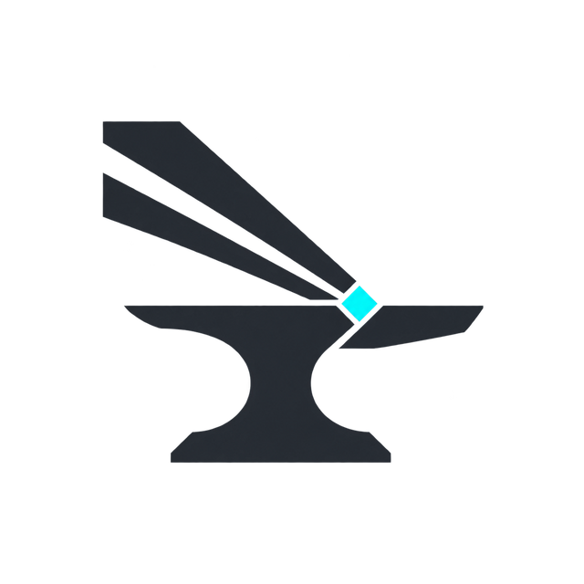
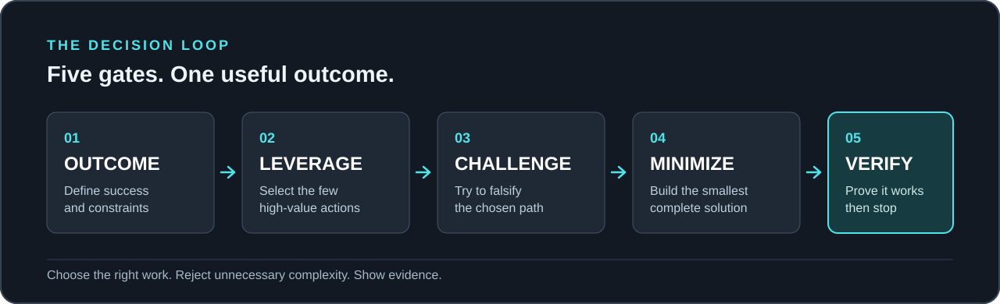

<div align="center">
  <picture>
    <source media="(prefers-color-scheme: dark)" srcset="../assets/pareto-forge-logo-on-dark.png">
    
  </picture>
  <h1>Pareto Forge</h1>
  <p><strong>Сначала польза. Вовремя остановись.</strong></p>
  <p>Skill для AI-агентов: получить достаточно полезный результат быстрее,<br>не тратя токены и время на необязательную работу.</p>
  <p><a href="https://www.skills.sh/kaigorodovtuskul/pareto-forge/pareto-forge"></a> <a href="../../LICENSE"></a></p>
  <p><a href="../../README.md">English</a> · <strong>Русский</strong></p>
</div>

---

## В чём идея

**Pareto Forge** применяет принцип 80/20 как эвристику исполнения: определить, что принесёт основную практическую пользу, быстро сделать рабочую версию и **остановиться**, когда дальнейшая полировка не оправдывает затрат.

Это не гарантия, что 20% усилий всегда дадут 80% результата. И это не разрешение пропускать явно обязательные требования, безопасность или корректность.

<p align="center"></p>

| Действие | Смысл |
|---|---|
| **Value** | Найти минимальный полезный результат и обязательные условия |
| **Cut** | Отложить второстепенное; переиспользовать готовое |
| **Ship** | Сделать работающую версию сейчас, без лишней инфраструктуры |
| **Stop** | Дёшево проверить ключевой сценарий и завершить задачу |

**Flash — режим по умолчанию:** простая задача выполняется сразу. **Focus** — короткое сравнение вариантов, только если выбор действительно есть. **Deep** — только для дорогих, рискованных, труднообратимых решений или по запросу.

## Пример

Пользователь просит простую демонстрацию Plotly на Streamlit. Агент делает одну работающую галерею с основными семействами графиков, примером данных и навигацией. Отдельная дизайн-система, перфекционизм и десятки тестов не нужны; достаточно проверить запуск. **Но если пользователь требует буквально все типы и вариации Plotly, сокращать охват без согласования нельзя.**

## Быстрый старт

```bash
npx skills add KaigorodovTuskul/pareto-forge --skill pareto-forge
```

Альтернативно — локальный установщик (Python 3.9+):

```bash
python scripts/install.py --project /path/to/your/project
```

Пример запроса агенту:

```text
Используй Pareto Forge. Нужна быстрая первая работающая версия дашборда.
Сделай полезный минимум, не добавляй необязательные фичи и остановись,
когда результат можно использовать. Коротко сообщи, что отложил.
```

## Бенчмарки

В [`benchmark/`](../../benchmark/README.md) подготовлены 30 заданий и сравнение Vanilla / Pareto Forge / Ponytail. Теперь основной критерий — **время и токены при достаточной полезности**, а не идеальность плана. Реальные результаты не получены; пока нельзя утверждать экономию. Скрипты проверены локально, но поведение LLM подлежит отдельному тестированию.

Полезные документы: [исследование референсов](../RESEARCH.md), [аудит](../DESIGN_AUDIT.md), [методика испытаний](../EVALUATION.md), [совместимость](../COMPATIBILITY.md), [первый запуск](../QUICKSTART_RU.md).

**Лицензия MIT.** За основу взяты общие принципы Парето, YAGNI и инженерного минимализма; сторонние skills в состав не входят.
